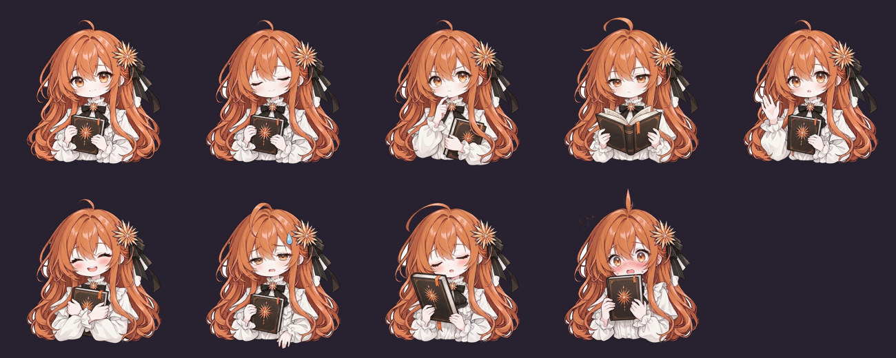
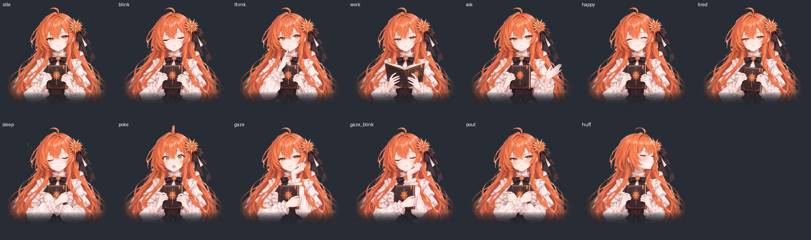

# Claude 大小姐

<p align="center"></p>

一个住在 Claude 桌面应用窗口角落的 Q 版小挂件。她会跟着 Claude 的工作状态换表情，告诉你 Claude 正在做什么，还会显示订阅额度。

橙色长发、星芒花发饰和黑缎带、米白荷叶边衬衫、抱着一本书，眼里有星芒高光。

> 粉丝自制的非官方作品，和 Anthropic 没有任何关系。「Claude」是 Anthropic 的商标，这里只用来说明它和什么软件一起用。

## 她会做什么



<sub>从左到右：待机、眨眼、思考、干活、等你确认、开心、累了 / 睡着、被点到、鼓腮生气、扭头不理你、托腮、托腮眨眼</sub>

**跟着 Claude 的状态换表情**

| Claude 在做什么 | 她的样子 |
|---|---|
| 在思考 | 手指抵着下巴 |
| 在用工具干活 | 低头翻书 |
| 等你点「允许」 | 举手看着你 |
| 一轮做完了 | 开心地笑 |
| 额度用到 80% 以上 | 冒汗、无精打采 |
| 出错了 | 冒汗，气泡变红 |
| 你一分半钟没说话 | 放下书，托着下巴静静看着你 |
| 15 分钟没动静 | 抱着书睡着，头顶冒 z |
| 你点她 | 呆毛竖起来，吓一跳 |
| 你连着戳她三下 | 鼓着腮帮子瞪你，然后扭过头去不理你，5 秒后才转回来 |
| 一轮里改了 3 个以上文件 | 多开心一会儿，头边有小星星闪，气泡写「改了 N 个文件」 |
| 你离开电脑 10 分钟以上又回来 | 挥挥手；如果睡着了会醒过来，托着下巴看你 |

**头顶的气泡**：只说事实，「在读 xxx.py」「在运行命令」「需要你确认一下」「做完啦」。出错时变红。凌晨做完事会顺便说一句现在几点。

**鼠标悬停**：看到 5 小时 / 7 天额度的详细百分比和重置时间，以及「刚才」做过的最近 6 件事，出错的那步标 ⚠️。

**贴着 Claude 窗口**：Claude 移动、缩放她都跟着；Claude 最小化她就藏起来；切到别的软件时她会被一起盖住，不会挡在前面；点她不会抢走输入框的焦点。

**拖动和吸附**：随便拖，松手时离 Claude 窗口边不到 40 像素就吸上去。位置会记住。

**开机自启**：电脑开机后她在后台安静等着，Claude 一打开她就出现。第一次运行时默认打开，不想要的话右键取消「开机就陪着我」。

**右键菜单**：调大小、换装、显示/隐藏额度和气泡、回到右下角、开关自启、让她先休息。

**换装**：除了 Q 版，还有一套「清冷」版：半身的她，清冷高傲但是温柔，13 个表情一样不少。右键「换装」切换。这套的样子是 Claude 自己决定、自己用 GPT 和 Gemini 画出来的。



## 怎么装

需要 **Windows**、**Python 3.10 以上**、**Claude Code**。

```bash
git clone https://github.com/nevery52/claude-ojousama.git
```

```bash
pip install --user PySide6-Essentials
```

然后在 `~/.claude/settings.json` 的 `env` 里加一行，指向这个项目的 `mod` 文件夹：

```json
{
  "env": {
    "CLAUDE_CODE_PLUGIN_DIRS": "D:\\你放项目的地方\\claude-ojousama\\mod"
  }
}
```

之后新开的 Claude Code 对话会自动加载插件，并叫醒大小姐。想立刻见到她，也可以直接双击 `overlay/launch.cmd`。

## 不想要她了

1. 右键她，取消「开机就陪着我」（会删掉 Windows「启动」文件夹里的「Claude 大小姐」快捷方式），再点「先休息」
2. 从 `~/.claude/settings.json` 的 `env` 里删掉 `CLAUDE_CODE_PLUGIN_DIRS` 那一行
3. 删掉整个项目文件夹。她的设置、状态和日志都在项目里的 `state/` 文件夹，不会留在别处

## 文件夹里有什么

```
claude-ojousama/
├── art/            立绘和表情
│   ├── base_v*.jpg     基础立绘的几版
│   ├── *_v*.jpg        各表情的原图
│   ├── cut/            抠掉白底的透明 PNG，程序实际用的
│   └── skin_cool/cut/  清冷版换装的表情
├── overlay/
│   ├── ojousama.py     桌面上的大小姐（PySide6 + Win32）
│   └── launch.cmd      不开黑窗口地叫醒她
├── mod/                Claude Code 感知插件
│   └── hooks/register.ts   监听工作状态和额度，写进 state/
├── tools/
│   ├── cutout.py       把白底立绘抠成透明
│   ├── cutout_bust.py  抠半身图：底边不当背景，往下渐渐淡出
│   ├── imagegen.py     让 Claude 自己调用 GPT / Gemini 画图
│   └── diff.py         对比两张图，检查表情差分对不对得齐
├── video/          介绍视频：画面、配乐、封面都是代码生成的
├── state/              运行时的状态、设置和日志（不进版本库）
└── gallery.html        表情一览，点缩略图切换
```

插件和大小姐之间通过 `state/sessions/<会话 id>.json` 传话：插件写，她每 0.4 秒读一次。

## 想换成自己的角色

把 `art/cut/` 里的 PNG 换成你自己的图就行，文件名对应各个状态：`idle`、`blink`、`think`、`work`、`ask`、`happy`、`tired`、`sleep`、`poke`，另外 `gaze` 和 `gaze_blink` 是可选的。

建议图是正方形、透明背景、人物底边在图片约 95% 的位置、头顶在约 8.5% 的位置。白底图可以用 `tools/cutout.py` 抠：

```bash
python tools/cutout.py 原图.jpg art/cut/idle.png
```

闭眼图建议沿用睁眼图的轮廓，眨眼时边缘才不会跳：

```bash
python tools/cutout.py 闭眼.jpg=睁眼.jpg art/cut/blink.png
```

换完图要重启大小姐（右键「先休息」，再双击 `overlay/launch.cmd`）。

## 致谢

形象由 寻耀 和 Claude 一起设计，提示词由 Claude 编写，用 GPT 和 Gemini 生成（AI 作图，不是手绘）。灵感来自 DeepSeek 鲸鱼娘挂件和二创圈里大家共创的 Claude 娘形象。

## 许可

- **代码**：[MIT](LICENSE)。随便用、随便改，注明出处就好。
- **立绘和表情**（`art/` 文件夹）：[CC BY-NC 4.0](art/LICENSE.md)。可以转发、可以二创，请署名「Claude 大小姐 by 寻耀 & Claude」，**不能用于商业用途**。
